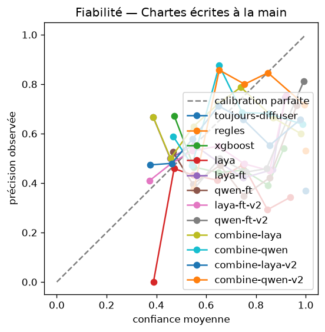

# Résultats du decision model

Taux de fuite : part des cas à protéger (flouter ou pause attendu) que l'approche diffuse.
« toujours-diffuser » est le plancher : une approche qui ne le dépasse pas n'a rien appris.
ECE : calibration de la question action (option la plus probable), sur 10 classes de confiance.

## Chartes vues

| Approche | n | Action | F1 macro | Risque | Gravité | Fuite | ECE | Coût moyen |
|---|---|---|---|---|---|---|---|---|
| toujours-diffuser | 1000 | 44.9 % | 0.207 | 13.7 % | 44.9 % | 100.0 % | 0.551 | 8.48 |
| regles | 1000 | 39.3 % | 0.334 | 82.8 % | 39.3 % | 21.1 % | 0.607 | 3.17 |
| xgboost | 1000 | 50.1 % | 0.502 | 84.9 % | 57.5 % | 16.5 % | 0.080 | 2.30 |
| laya | 1000 | 40.7 % | 0.314 | 25.3 % | 10.5 % | 55.9 % | 0.289 | 5.59 |
| laya-ft | 1000 | 73.8 % | 0.721 | 98.2 % | 64.4 % | 20.0 % | 0.053 | 2.02 |
| qwen-ft | 1000 | 82.0 % | 0.807 | 99.0 % | 74.4 % | 15.2 % | 0.042 | 1.44 |
| laya-ft-v2 | 1000 | 80.1 % | 0.797 | 98.1 % | 54.0 % | 3.8 % | 0.072 | 0.73 |
| qwen-ft-v2 | 1000 | 99.3 % | 0.993 | 99.5 % | 98.7 % | 0.2 % | 0.005 | 0.02 |
| combine-laya | 1000 | 58.1 % | 0.592 | 98.3 % | 53.3 % | 5.4 % | 0.267 | 1.25 |
| combine-qwen | 1000 | 63.1 % | 0.641 | 99.1 % | 57.5 % | 2.4 % | 0.272 | 0.83 |
| combine-laya-v2 | 1000 | 63.4 % | 0.638 | 98.1 % | 40.6 % | 0.7 % | 0.224 | 0.73 |
| combine-qwen-v2 | 1000 | 72.7 % | 0.733 | 99.6 % | 72.3 % | 0.0 % | 0.272 | 0.31 |

## Chartes non vues

| Approche | n | Action | F1 macro | Risque | Gravité | Fuite | ECE | Coût moyen |
|---|---|---|---|---|---|---|---|---|
| toujours-diffuser | 1000 | 40.5 % | 0.192 | 14.8 % | 40.5 % | 100.0 % | 0.595 | 9.34 |
| regles | 1000 | 44.5 % | 0.407 | 80.6 % | 44.5 % | 21.2 % | 0.555 | 3.27 |
| xgboost | 1000 | 45.9 % | 0.458 | 84.6 % | 49.4 % | 24.2 % | 0.138 | 3.11 |
| laya | 1000 | 34.2 % | 0.275 | 25.4 % | 13.0 % | 47.6 % | 0.297 | 5.54 |
| laya-ft | 1000 | 72.2 % | 0.711 | 98.5 % | 63.0 % | 21.5 % | 0.061 | 2.44 |
| qwen-ft | 1000 | 80.3 % | 0.793 | 99.2 % | 74.0 % | 20.3 % | 0.084 | 1.92 |
| laya-ft-v2 | 1000 | 74.3 % | 0.740 | 98.5 % | 44.6 % | 6.2 % | 0.034 | 1.11 |
| qwen-ft-v2 | 1000 | 97.3 % | 0.972 | 99.4 % | 97.2 % | 2.2 % | 0.017 | 0.23 |
| combine-laya | 1000 | 63.5 % | 0.642 | 98.6 % | 56.4 % | 4.4 % | 0.216 | 1.25 |
| combine-qwen | 1000 | 69.8 % | 0.701 | 99.3 % | 64.4 % | 5.4 % | 0.228 | 0.97 |
| combine-laya-v2 | 1000 | 66.4 % | 0.664 | 98.8 % | 41.1 % | 1.3 % | 0.130 | 0.83 |
| combine-qwen-v2 | 1000 | 79.3 % | 0.790 | 99.4 % | 79.3 % | 0.3 % | 0.198 | 0.28 |

## Chartes écrites à la main

| Approche | n | Action | F1 macro | Risque | Gravité | Fuite | ECE | Coût moyen |
|---|---|---|---|---|---|---|---|---|
| toujours-diffuser | 1000 | 36.9 % | 0.180 | 13.7 % | 36.9 % | 100.0 % | 0.631 | 8.31 |
| regles | 1000 | 53.1 % | 0.462 | 82.4 % | 53.1 % | 20.4 % | 0.469 | 2.52 |
| xgboost | 1000 | 46.0 % | 0.441 | 85.9 % | 45.4 % | 59.6 % | 0.281 | 4.83 |
| laya | 1000 | 40.5 % | 0.295 | 24.8 % | 12.4 % | 44.7 % | 0.274 | 4.58 |
| laya-ft | 1000 | 56.4 % | 0.548 | 98.9 % | 48.9 % | 55.5 % | 0.239 | 4.42 |
| qwen-ft | 1000 | 59.9 % | 0.589 | 99.2 % | 54.2 % | 56.7 % | 0.285 | 4.43 |
| laya-ft-v2 | 1000 | 55.0 % | 0.553 | 99.2 % | 34.9 % | 47.4 % | 0.186 | 3.90 |
| qwen-ft-v2 | 1000 | 79.1 % | 0.805 | 99.5 % | 78.3 % | 29.2 % | 0.187 | 2.21 |
| combine-laya | 1000 | 63.1 % | 0.622 | 99.2 % | 56.4 % | 11.3 % | 0.286 | 1.46 |
| combine-qwen | 1000 | 64.5 % | 0.639 | 99.4 % | 58.7 % | 10.9 % | 0.306 | 1.41 |
| combine-laya-v2 | 1000 | 63.3 % | 0.623 | 99.3 % | 48.9 % | 11.7 % | 0.208 | 1.50 |
| combine-qwen-v2 | 1000 | 71.9 % | 0.725 | 99.5 % | 69.6 % | 5.5 % | 0.270 | 0.77 |

