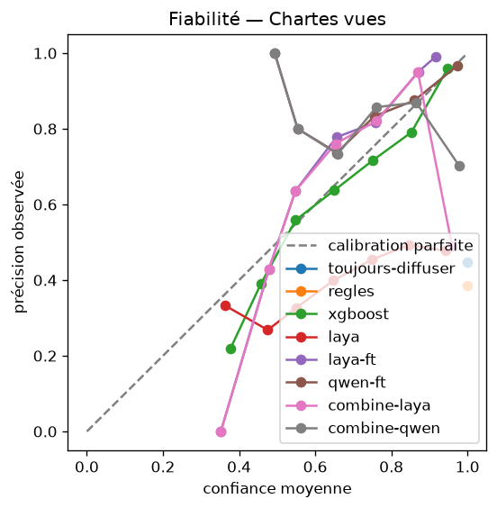
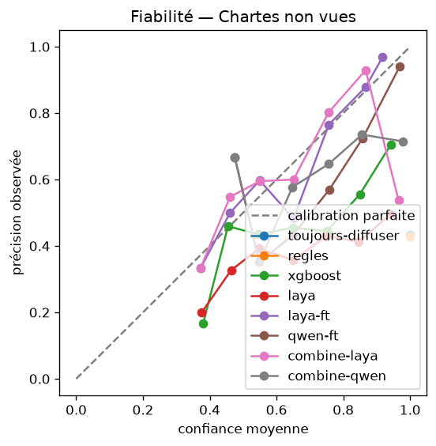

# Résultats du decision model

Taux de fuite : part des cas à protéger (flouter ou pause attendu) que l'approche diffuse.
« toujours-diffuser » est le plancher : une approche qui ne le dépasse pas n'a rien appris.
ECE : calibration de la question action (option la plus probable), sur 10 classes de confiance.

## Chartes vues

| Approche | n | Action | F1 macro | Risque | Gravité | Fuite | ECE | Coût moyen |
|---|---|---|---|---|---|---|---|---|
| toujours-diffuser | 1000 | 44.8 % | 0.206 | 12.6 % | 44.8 % | 100.0 % | 0.552 | 8.53 |
| regles | 1000 | 38.5 % | 0.331 | 80.4 % | 38.5 % | 23.7 % | 0.615 | 3.37 |
| xgboost | 1000 | 60.3 % | 0.605 | 84.2 % | 63.7 % | 14.7 % | 0.034 | 1.96 |
| laya | 1000 | 38.1 % | 0.303 | 27.6 % | 11.0 % | 36.2 % | 0.281 | 4.31 |
| laya-ft | 1000 | 91.2 % | 0.909 | 99.0 % | 92.2 % | 2.4 % | 0.078 | 0.34 |
| qwen-ft | 1000 | 94.6 % | 0.945 | 99.6 % | 94.5 % | 1.8 % | 0.015 | 0.20 |
| combine-laya | 1000 | 69.2 % | 0.697 | 99.3 % | 70.2 % | 0.9 % | 0.256 | 0.50 |
| combine-qwen | 1000 | 71.3 % | 0.716 | 99.6 % | 71.2 % | 0.9 % | 0.257 | 0.42 |

## Chartes non vues

| Approche | n | Action | F1 macro | Risque | Gravité | Fuite | ECE | Coût moyen |
|---|---|---|---|---|---|---|---|---|
| toujours-diffuser | 1000 | 43.4 % | 0.202 | 15.5 % | 43.4 % | 100.0 % | 0.566 | 8.93 |
| regles | 1000 | 42.9 % | 0.387 | 80.7 % | 42.9 % | 22.6 % | 0.571 | 3.33 |
| xgboost | 1000 | 45.5 % | 0.424 | 86.0 % | 49.7 % | 40.1 % | 0.196 | 4.37 |
| laya | 1000 | 35.9 % | 0.289 | 24.2 % | 10.3 % | 47.5 % | 0.293 | 5.35 |
| laya-ft | 1000 | 79.9 % | 0.783 | 98.9 % | 81.8 % | 14.7 % | 0.039 | 1.41 |
| qwen-ft | 1000 | 84.6 % | 0.831 | 99.5 % | 84.8 % | 13.6 % | 0.067 | 1.19 |
| combine-laya | 1000 | 67.1 % | 0.676 | 99.1 % | 67.9 % | 3.7 % | 0.220 | 0.85 |
| combine-qwen | 1000 | 69.7 % | 0.697 | 99.8 % | 69.9 % | 3.7 % | 0.238 | 0.73 |

